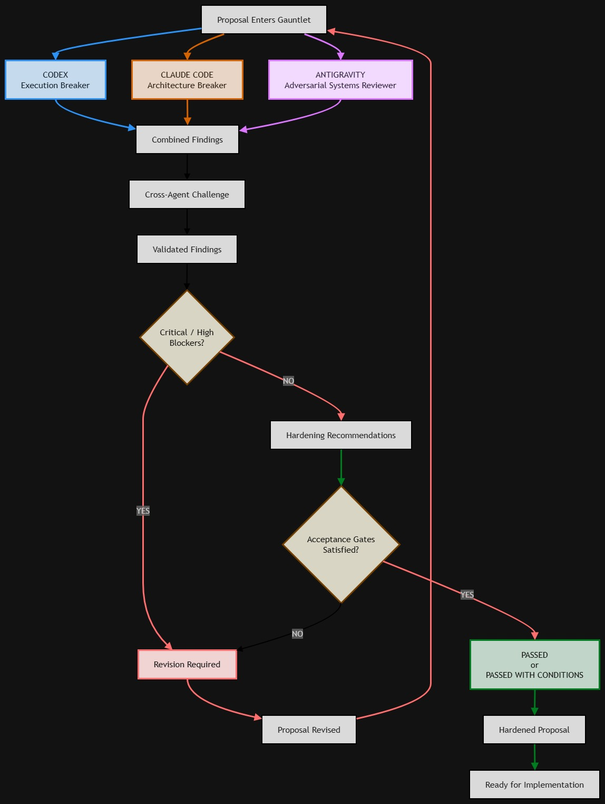

# Gauntlet

Gauntlet is an adversarial, multi-agent review workflow for proposal and project material. It runs inside `geekygramps-mcp` as a [DBOS](https://docs.dbos.dev/) durable workflow and uses the shared agent-runner service to invoke three independent reviewers. Runs are launched, tracked, remediated, revised, and closed from [The Arena](https://github.com/fbrawner3/the-arena).

Gauntlet is intentionally separate from [Triple-Threat](https://github.com/fbrawner3/triple-threat). Triple-Threat owns project planning, approvals, implementation, validation, and handoff. Gauntlet is an independent pressure test of the material before or alongside that work.

## What a run does

1. Takes the proposal text supplied with the run (an optional source note or folder identifier can be passed along for the reviewers to read).
2. Runs independent reviews from Claude, Codex, and Antigravity.
3. Runs a cross-agent challenge over the proposal and the three reviews. Findings that survive are the validated findings.
4. Derives a verdict from reviewer failures and high-severity findings.
5. Has a finalizer agent produce the consolidated report, verdict, and per-reviewer artifacts.
6. Persists workflow state, reviews, findings, challenges, and the final artifact in PostgreSQL.

Every independent review returns a Markdown report followed by a machine-readable JSON findings block. Findings are parsed on a best-effort basis, so a review never depends on parsing succeeding.

## Review roles

| Reviewer | Focus |
| --- | --- |
| Claude | Architecture, assumptions, state transitions, dependencies, and failure domains |
| Codex | Commands, APIs, schemas, permissions, authentication, retries, and execution behavior |
| Antigravity | Adversarial systems behavior, abuse cases, operator recovery, scaling, and maintainability |

Findings carry a severity (`critical`, `high`, `medium`, `low`, `observation`) and a category (`dependency`, `logic`, `security`, `state`, `operations`, `rollback`, `ambiguity`).

## Verdicts

The workflow produces one of `PASSED`, `PASSED_WITH_CONDITIONS`, `REVISION_REQUIRED`, or `REJECTED`. Two more values are set by the operator rather than the reviewers:

- `ACCEPTED`: the operator closes a finished round. Findings still open are recorded as accepted residual risk.
- `INVALID`: a passed run whose stored reports were deleted is voided so it no longer counts as a result.

## Revision loop

The loop is human-driven. Nothing re-runs on its own.

1. Review the validated findings from a round.
2. Save a remediation decision against each finding you want addressed.
3. Revise: the workflow applies those remediations to the package files in place, then starts the next round linked to the previous one. The linked round's reviewers receive the prior findings and your recorded decisions as context instead of reviewing cold.
4. Repeat, or accept the round.

## Output modes

A run's `outputMode` controls where the finalizer writes its reports:

- `vector` (default): reports are filed to the shared vector memory store.
- `export`: reports are written as plain Markdown files to a local folder and zipped, with no vector-memory involvement, so a run on someone else's project can be handed off cleanly.

## HTTP API

The MCP service exposes these routes:

| Method | Route | Purpose |
| --- | --- | --- |
| `POST` | `/gauntlet/runs` | Start a DBOS workflow |
| `GET` | `/gauntlet/runs/:workflowId` | Read persisted run state |
| `GET` | `/gauntlet/runs/:workflowId/artifact` | Retrieve the consolidated artifact |
| `GET` | `/gauntlet/runs/:workflowId/findings` | Retrieve structured findings |
| `POST` | `/gauntlet/runs/:workflowId/findings/:findingRef/remediate` | Save a remediation decision for one finding |
| `POST` | `/gauntlet/runs/:workflowId/revise` | Apply saved remediations and start the next linked round |
| `POST` | `/gauntlet/runs/:workflowId/accept` | Close a finished round as `ACCEPTED` |
| `POST` | `/gauntlet/runs/:workflowId/cancel` | Cancel a running round |
| `POST` | `/gauntlet/runs/:workflowId/purge-memory` | Delete a run's stored reports and void its verdict |
| `POST` | `/gauntlet/backfill-memory` | Re-file saved remediations to vector memory |

A start request includes `proposalName`, `proposal`, `requestedBy`, and `idempotencyKey`. Optional fields include `projectSlug`, `projectDir`, `outputMode`, `previousWorkflowId`, and a source note identifier. Run IDs have the form `<project-slug>-run-<n>`.

## Durable state

DBOS provides durable workflow execution and PostgreSQL-backed state. Gauntlet stores:

- run status, proposal, verdict, final artifact, and failure information;
- independent reviewer output;
- cross-agent challenge output; and
- structured findings, their dispositions, and operator remediations.

The database must be initialized before the workflow starts. The service's initialization script provisions the DBOS application tables and the Gauntlet tables.

## Boundaries

- Gauntlet owns its contracts, prompts, workflow, persistence, routes, and agent-runner client in this directory.
- Its agent-runner client is a Gauntlet-specific copy, so a change here cannot alter Triple-Threat behavior.
- The finalizer prompt forbids external repository integrations and services, and the revise prompt forbids git commands and writes outside the package directory.
- A run is not complete until the final report artifacts exist and the result is recorded.

## Source files

- `src/workflow.ts`: DBOS workflow orchestration and reviewer/finalizer/revise execution
- `src/routes.ts`: HTTP API routes
- `src/agentRunnerClient.ts`: Gauntlet-specific agent-runner HTTP contract
- `src/prompts.ts`: reviewer, cross-agent challenge, revise, and finalizer prompts
- `src/findings.ts`: structured findings extraction and validation
- `src/store.ts`: PostgreSQL persistence
- `src/types.ts`: Gauntlet-only contracts and verdict, severity, and category enums

## Notes

This is a personal homelab tool, published for portfolio purposes. It is a reference implementation extracted from a larger private service: shared modules it imports (service configuration, DBOS bootstrap, the vector memory store) are not included, so it will not build on its own.
